# 🔐 Cybersecurity Lab Environment Setup

**Building an isolated virtual lab for penetration testing and ethical hacking practice**

## 📌 Project Overview

This project focuses on setting up a **virtual cybersecurity and penetration-testing laboratory** using VirtualBox and Kali Linux.

The purpose of the lab is to create a controlled environment where cybersecurity tools, network scanning, reconnaissance, vulnerability assessment, and other security-testing activities can be performed safely and repeatedly.

The lab is configured on a private virtual network so that additional machines can be added later and used as targets for authorized security testing.

---

## 🎯 Tasks
<ul>
  <li>Use Virtualbox as base (latest recommended version)</li>
  <li>Setup Kali Linux as attacking/hacker machine</li>
  <li>Setup the network in subnet 10.0.0.0/24</li>
  <li>Use NATNetwork with 10.0.0.0/24</li>
  <li>The clipboard & file drag/drop should be enabled in Virtual Machine settings</li>
  <li>Shared folders should be enabled with /downloads folder shared from host machine</li>
  <li>Kali Linux IP Address should be 10.0.0.2/24</li>
  <li>Kali Linux should have full Internet access</li>
</ul>

---

## ⚙️ Lab Configuration

| 🧩 Component       | ⚙️ Configuration   |
| ------------------ | ------------------  |
| 🖥️ Host OS         | Windows 10         |
| 🧠 Host RAM        | 4 GB               |
| ⚡ Processor       | AMD A4-9125 RADEON R3, 4 COMPUTE CORES 2C+2G      |
| 🧰 Hypervisor      | VirtualBox 7.2.22 r175245 |
| 🐉 Security OS     | Kali Linux 2026.3  |
| 🧠 Kali RAM        | 1536 MB            |
| 🌐 Virtual Network | NAT Network        |
| 📡 Network Address | 10.0.0.0/24        |
| 🐧 Kali IP Address | 10.0.0.2/24        |
| 🚪 Default Gateway | 10.0.0.1           |
| 🌍 DNS Server      | 8.8.8.8            |

# 🪜 Lab Setup Procedure

## 1. Installed latest Oracle VirtualBox-7.2.22 and imported the latest kali-linux-2026.3-virtualbox-amd64
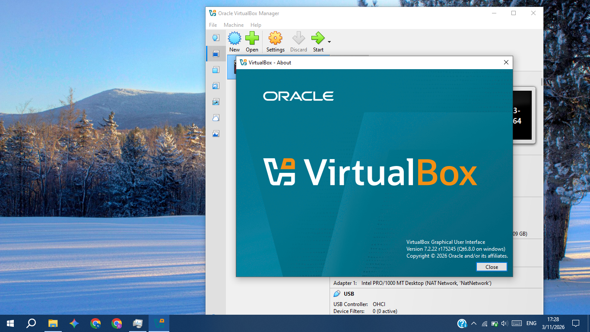
## 2. Added the VM network in subnet 10.0.0.0/24 using a NAT network
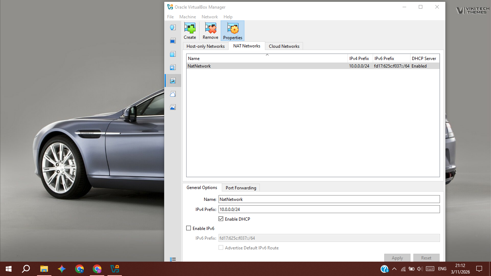
## 3. Ensured the clipboard and drag and drop support is enabled
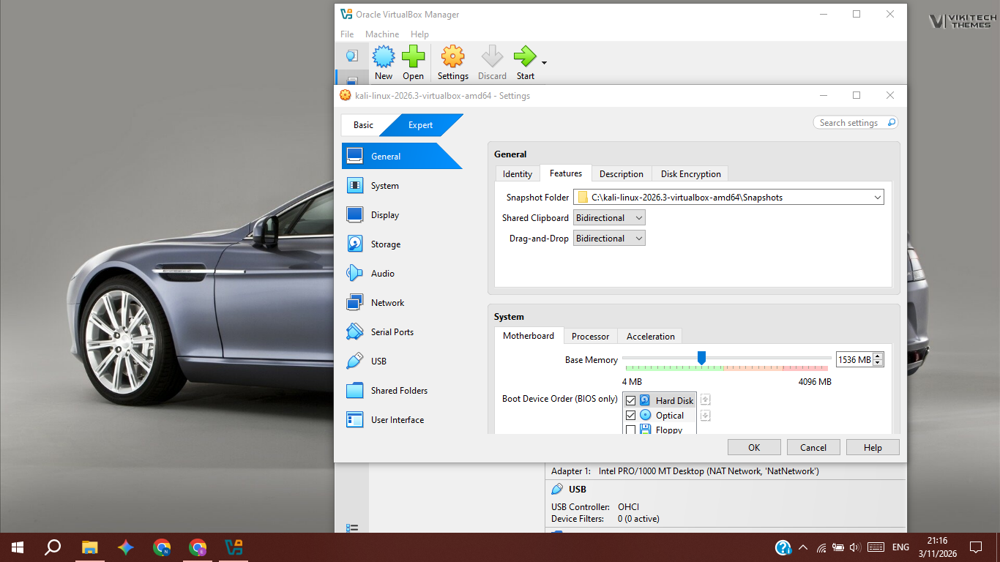
## 4. Adjusted the memory to a suitable low value e.g. 1.5GB to support this low end computer
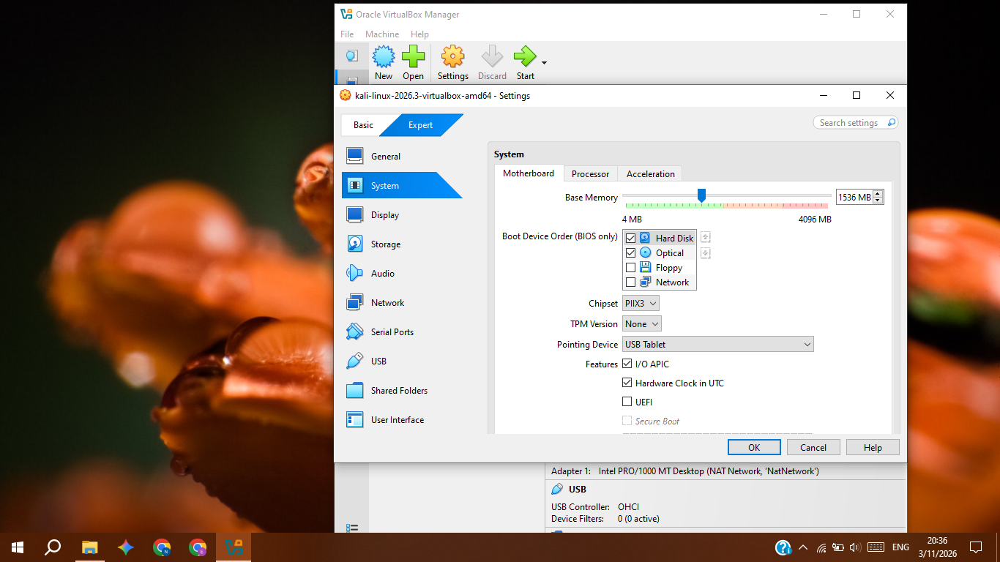
## 5. Enabled the virtual machine adapter to use the NAT network provided by the virtualbox
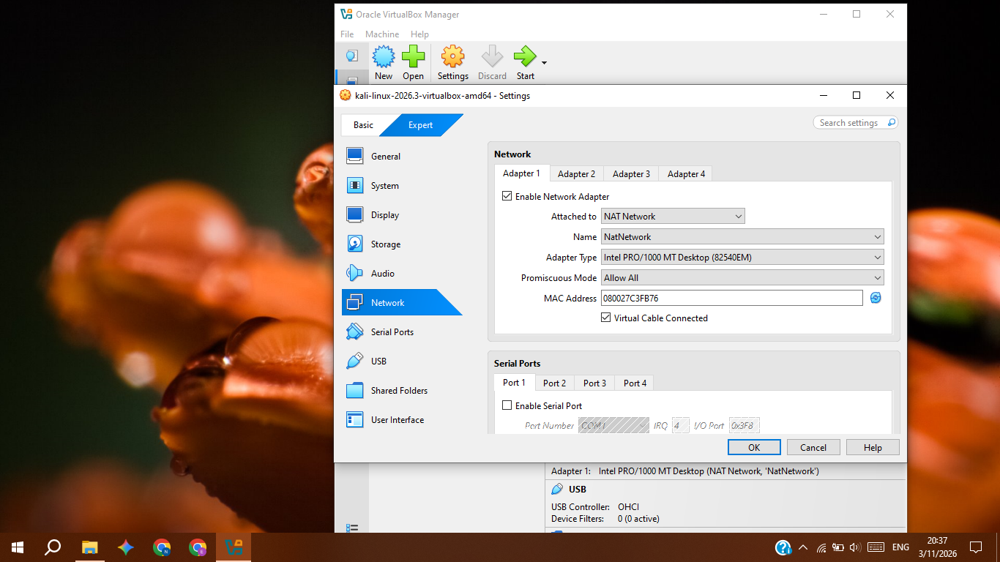
## 6. Linked the VM's shared folder to access the Host "Downloads" user folder
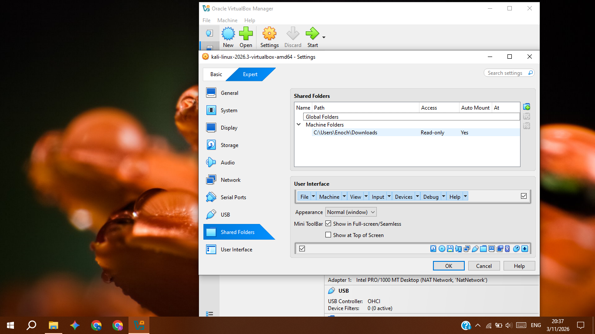
## 7. Booted the kali linux virtual machine and checked the pc performance with the given settings
Homescreen
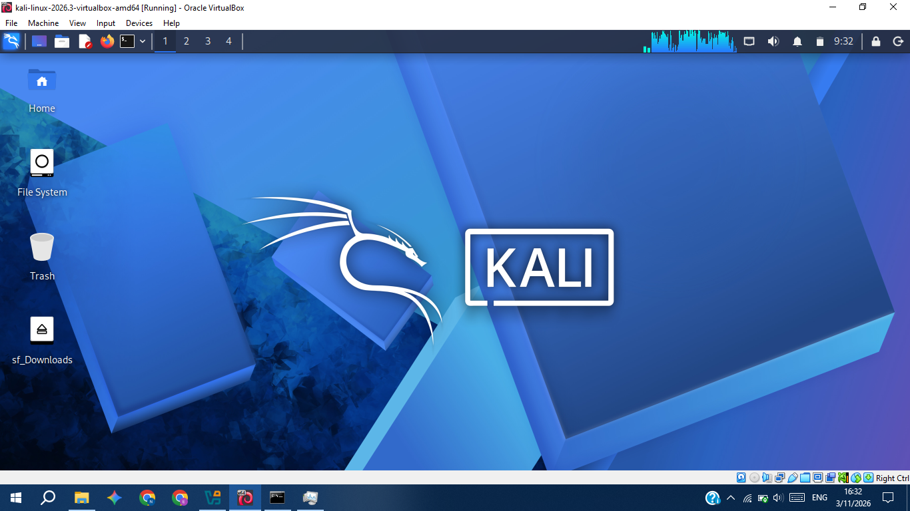
---
Command to view process lists
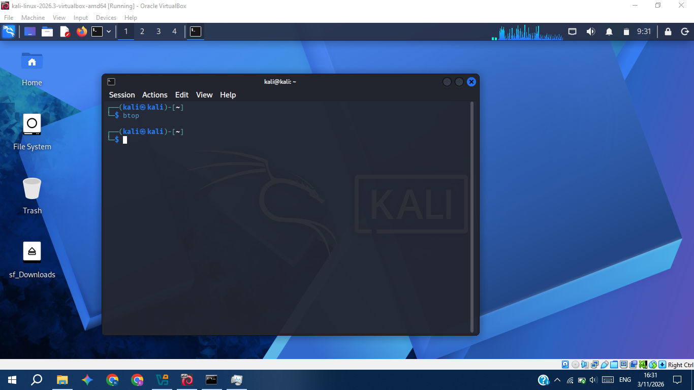
---
Process view, seeing around 725MB available space in the kali linux VM
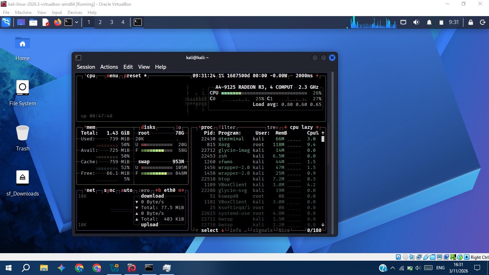
---
Comparing with the host perfomance view
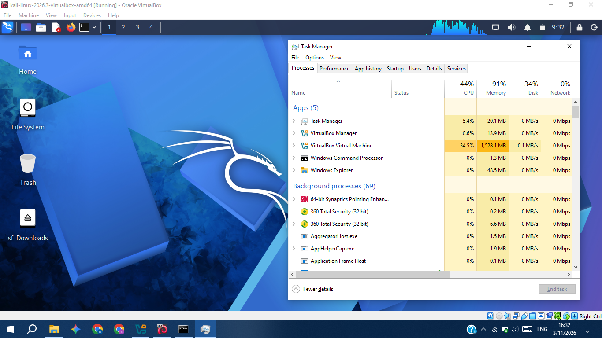
## 8. Setting Kali Linux VM IP Address to 10.0.0.2/24 and default gateway to 10.0.0.1
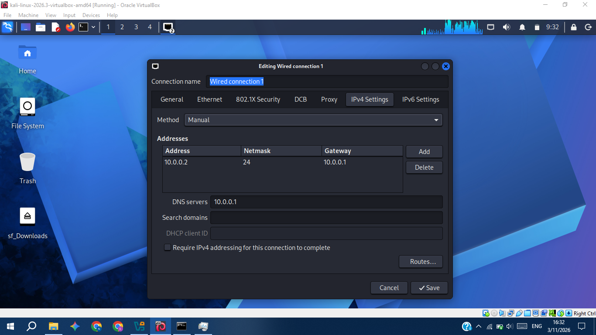

## 9. Internet connectivity check
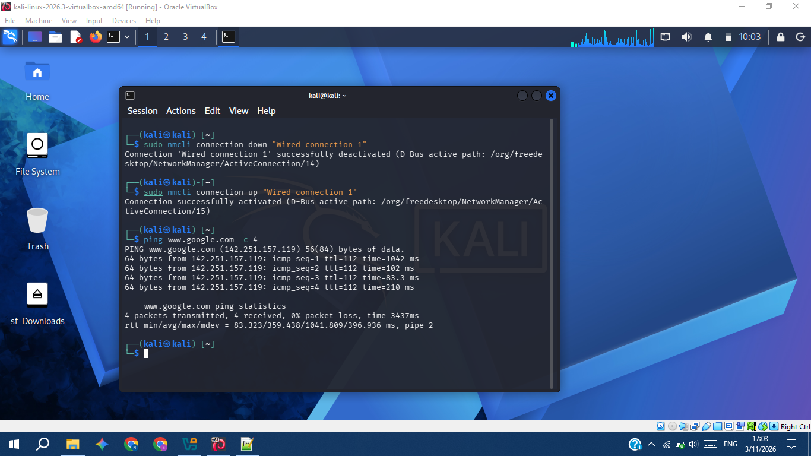

# 🐞 Problems Encountered & Solutions
**Problem** : On first attempt on step 1, after installing virtual box and imported kali linux, when i tried to change the settings while the kali linux VM was running, all the options were grayed, and no setting could be modified.

**Solution** : Shutdown the VM first then change the settings

**Problem** :  After restart kali linux 2026.3, wired connection refused to connect.

**Solution** : Manually connected to the wired connection using, **sudo nmcli connection up "Wired connection 1"**

# 💡 What I Learned
Learned how to setup a VirtualBox, a Virtual Machine. How to adjust the VM memory settings to balance the memory usage between the Host and the VM. Setting up a subnet for the VM, and about virtual networks IP addresses for the virtual machines. Learned to take snapshots of each VM to run it again later with the same configurations in an event of a system crash or vulnerability.

# 🔗 Tools & Resources

- **7-Zip:** [https://7-zip.org/download.html](https://7-zip.org/download.html)
- **VirtualBox:** [https://virtualbox.org/wiki/Downloads](https://virtualbox.org/wiki/Downloads)
- **Kali Linux:** [https://kali.org/get-kali](https://kali.org/get-kali)

---

# 👤 Author

**Enoch Muza**\
Cybersecurity Intern B084

LinkedIn: [www.linkedin.com/in/enoch-m-04aba5432](https://www.linkedin.com/in/enoch-m-04aba5432)

---

## 📌 Project Information

**Program Name:** Cybersecurity at Networkwalks | **Week:** 01 | **Project:** Cybersecurity & Pentesting Lab Setup | **Repository:** GitHub
